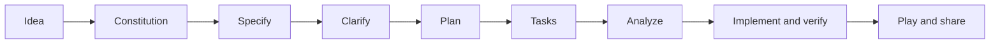

# NAF AC6 · Build a Networking Game

**Turn a networking concept into a game someone can learn from—and a GitHub project you can show.**

Workshop materials for **Loop Engineering, Spec-Driven Development & the Future of VibeOps**, led by John Capobianco, Joksan Flores, and Elliot Conner.

You'll define the learning experience, give your coding agent a clear specification, build a small browser game, and verify that it teaches the right thing. Your finished repository should explain what you built, how to play, and how you checked it.

**[Start the lab →](WORKSHOP/LAB/README.md)** · **[Get the templates](WORKSHOP/LAB/StarterKit/)** · **[See a worked example](WORKSHOP/LAB/Examples/PrefixQuest/README.md)**

## Play the completed example

**[Per-Hop Works](WORKSHOP/LAB/Examples/PerHopWorks/README.md)** is a working 3D packet-factory
game with twelve DiffServ lessons, a beginner introduction, a keyboard-accessible schematic view
and an immediately available presentation Demo. From this repository's root:

```sh
python3 WORKSHOP/LAB/Examples/PerHopWorks/start.py
```

It opens **http://localhost:8000**. Playing requires Python 3.11+ and a desktop browser, with no
API key, package installation or build step. Its README documents the
[prompts and five-loop Spec Kit build](WORKSHOP/LAB/Examples/PerHopWorks/research/BUILD_PROMPTS.md)
and the [measured build time, tokens and estimated cost](WORKSHOP/LAB/Examples/PerHopWorks/research/BUILD_LEDGER.md).

## Your workshop kit

| Resource | What it's for |
| --- | --- |
| [Lab walkthrough](WORKSHOP/LAB/README.md) | Setup, the seven Spec Kit steps, checkpoints, troubleshooting, and your demo |
| [CONSTITUTION.md](WORKSHOP/LAB/StarterKit/CONSTITUTION.md) | The rules your game must uphold |
| [SPEC.md](WORKSHOP/LAB/StarterKit/SPEC.md) | Players, learning outcomes, gameplay, and testable success criteria |
| [PLAN.md](WORKSHOP/LAB/StarterKit/PLAN.md) | Implementation choices, data contracts, and verification |
| [Attendee README template](WORKSHOP/LAB/StarterKit/README.md) | Copy to **your repository root** and personalize |
| [Prefix Quest example](WORKSHOP/LAB/Examples/PrefixQuest/README.md) | A completed set of planning documents and concrete test inputs; no game implementation included |
| [Per-Hop Works game](WORKSHOP/LAB/Examples/PerHopWorks/README.md) | Playable twelve-level 3D/SVG game, five-loop Spec Kit evidence, prompts and build ledger |
| [Workshop slides](WORKSHOP/LECTURE/NAF%20AC6%20Workshop%20-%20Itential.pptx) | Lecture and lab context |
| [Talk slides](TALK/Itential-NAF%20AC6.pptx) | Companion presentation |

## What you'll make

A focused educational game: choose a packet's exit, evaluate an ACL, build a subnet, or trace a DNS lookup. The player's main action should practice the skill you're teaching. Every decision should produce an explanation they can use on the next attempt.

The recommended workshop build has **one core mechanic, three short levels, deterministic answers, and no backend**. Visual ambition is welcome; finish one complete learning loop before adding more systems.



Your coding agent helps build the game. The recommended game itself runs without an AI model. Ralph loops, rendering libraries, and additional build tools are optional extensions after the basic experience works.

## Work in a repository you own

Create your own GitHub repository. Copy the three planning templates into a `StarterKit/` folder, and copy the attendee README to the root. Keep this repository open as your reference. The [lab walkthrough](WORKSHOP/LAB/README.md) shows the exact layout and setup steps.

Before sharing, make one deliberately wrong move. If the game can't explain it clearly—or marks an incorrect decision as correct—keep improving that part.

## Credits and resources

Based on John Capobianco's [Networking Video Game Starter Kit](https://github.com/automateyournetwork/NetworkingVideoGameStarterKit) and the workshop deck in this repository. The workflow uses [GitHub Spec Kit](https://github.com/github/spec-kit).

Workshop repository license: [Apache 2.0](LICENSE).
